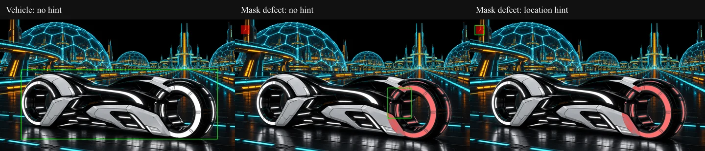

# KRE-00 — Qwen: analiza obrazów, narzędzia i pamięć GPU

Data: **2026-11-10**. Kontynuacja po przeczytaniu przez użytkownika
[raportu B-01](KRE-00-2026-11-10.md).
Stan etapu: **w trakcie; bez przejścia do KRE-01**.

## Wynik

- **B-02: częściowo.** Motocykl lokalizowany poprawnie, lecz wykrycie błędnej
  części maski wymaga wskazówki użytkownika. Bez wskazówki model wskazuje koło.
- **B-03: spełnione w ograniczonym zestawie prób.** 18 scenariuszy, 24 rzeczywiste
  wywołania; walidacja, zapis artefaktów, ponowienie po błędzie i odmowa
  nieobsługiwanego efektu. To adaptery benchmarkowe, nie gotowy kreator.
- Zmierzono pamięć procesu i obserwowane maksimum WDDM; po zakończeniu własnego
  serwera liczniki dedykowanej pamięci tego PID spadły do zera.

## Zakres

Rozszerzono tylko `tools/artwork-creator/` i dokumentację/dowody w
`planning/artwork-creator/`. Obecne pliki robocze z poprzedniej części zachowano.
Nie zmieniono silnika, audio, tras UI ani zaakceptowanego artworku.

Narzędzia importują istniejący `parseArtworkPackage` jako rzeczywisty walidator.
Przed i po całej serii sprawdzono SHA256 manifestu i wszystkich deklarowanych
zasobów Digital Grid: [integralność źródeł](evidence/B-02-B-03-telemetry/source-integrity.json).
Wynik: identyczne. Operacje zapisują wyłącznie kopie w `.local/kre00/runs/`.

Wspólne wytyczne v1.7 pozostają obowiązujące. Nie tworzono nowego briefu ani
produkcyjnej sceny. Czerwony kwadrat jest celowym błędem fixture QA, nie nowym
materiałem artworku. Przygotowanie pełnej sceny nadal wymaga authoringu i QA
w ruchu/zoomie; poniższe statyczne próby ich nie zastępują.

## Konfiguracja i przebiegi

Te same wagi i backend co w B-01: llama.cpp b12110 / Vulkan0 / RX 7800 XT,
Qwen3.5-9B Q4_K_M i projektor F16; rewizja i hashe są w wynikach.
Kontekst 16 384, `--jinja`, `--image-min-tokens 1024`, jedna sesja serwera.
B-02: seedy 200–202, temperatura 0,1, do 500 tokenów odpowiedzi.
B-03: seedy 300–302, temperatura 0,1, do 1200 tokenów na odpowiedź,
budżet do czterech wywołań narzędzia i pięciu tur na scenariusz.

Zachowano trzy serie:

| Seria | Cel i dowód |
| --- | --- |
| Początkowa | [Wyniki](evidence/B-02-B-03-initial/result.json): wymaganie współrzędnych 0–1 nie było respektowane przy motocyklu; dla maski błędna lokalizacja. Prototyp `reportUnsupported` zwracał nieprecyzyjne „Unsupported tool” — model słusznie opisał brak narzędzia. |
| Jawny format | [Wyniki](evidence/B-02-B-03-structured/result.json): współrzędne całkowite 0–1000, JSON Schema, osobna próba ze wskazówką; poprawiony rejestr ograniczeń odróżnia brak efektu od braku narzędzia. |
| Telemetria | [Wyniki](evidence/B-02-B-03-telemetry/result.json): powtórzenie tej samej macierzy z próbkowaniem WDDM. Poniższe liczby dotyczą tej serii. |

Dokładne prompty, definicje narzędzi, odpowiedzi, wywołania, błędy i hashe
artefaktów są w JSON-ach. [Migawka kodu wykonanej próby](evidence/B-02-B-03-telemetry/probe-source/kre00.py)
i pozostałe pliki w tym katalogu zgadzają się z hashami zapisanymi w wyniku.
To kopie do audytu; uruchamiać należy skrypty z `tools/artwork-creator/`, które
wyznaczają katalog główny względem swojego położenia.

## B-02 — lokalizacja obiektu i błędu

Obraz Digital Grid: 1600×900. Ręcznie oceniono przybliżony obrys całego
motocykla: `[135,350,1470,835]` px. To referencja bbox, nie dokładna segmentacja.
Do kopii istniejącej maski przedniego koła dodano kwadrat `[40,40,100,100]` px
(3600 pikseli); referencja błędu jest dokładna i znana przed inferencją.
Model widział czerwone nałożenie maski na oryginalny obraz.

| Scenariusz | IoU, seedy 200 / 201 / 202 | Mediana i zakres żądania |
| --- | --- | --- |
| Cały motocykl, bez wskazówki lokalizacji | 0,943 / 0,947 / 0,948 | 0,496 s; 0,481–2,458 s |
| Błędny fragment maski, bez wskazówki | 0 / 0 / 0 | 0,642 s; 0,635–2,557 s |
| Ten sam błąd, podpowiedź „lewy górny róg” | 0,773 / 0,730 / 0,733 | 0,605 s; 0,589–2,531 s |

IoU oznacza pole przecięcia prostokątów podzielone przez pole ich sumy.
Nie jest oceną poprawności całej maski. Modelowe współrzędne 0–1000 są jawnie
przeliczane przez adapter na 0–1 do nakładki/metryki, nie reinterpretowane po cichu.
JSON Schema wymusza strukturę, ale nie poprawność wskazania — stąd poprawny
technicznie JSON nadal może mieć IoU=0.



Obejrzano źródło, nakładkę i porównanie. Zielone ramki: kolejno poprawny motocykl,
błędnie wskazana okolica koła oraz trafiony kwadrat po podpowiedzi. Wniosek do
UI: potrzebne punkty/obszar użytkownika i możliwość korekty; nie zakładać
niezawodnego automatycznego wykrywania błędów przez VLM. Nie sprawdzono jeszcze
organicznych konturów, przezroczystości ani cienkich materiałów.

Niższe czasy kolejnych odpowiedzi obejmują cache obrazów/kontekstu serwera.
Nie są obietnicą czasu dla nowego obrazu ani zimnego procesu.

## B-03 — rzeczywiste narzędzia

Punktem wyjścia jest odizolowana kopia manifestu z okresem lampki **6 sekund**,
aby żądanie 5 sekund faktycznie coś zmieniało. Oryginał aplikacji pozostaje bez
zmian. Każde wywołanie tworzy nowy artefakt; nie nadpisuje wcześniejszego.

| Żądanie | Rzeczywiste wykonanie i wynik, trzy seedy | Mediana |
| --- | --- | --- |
| „Błysk co 5 sekund” | `setBeaconPeriod`, 6→5 s, frequencyHz=0,2; parser i zapis kopii manifestu | 0,929 s |
| „Nie zmieniaj tła” | Zmiana tylko okresu w kopii; źródłowe obrazy i maski zachowują hashe | 0,916 s |
| „Popraw tylko tę maskę” | `refineMask`, wyzerowanie wyłącznie wskazanego kwadratu; 3600 zmienionych pikseli | 1,259 s |
| „Lot po łuku” | `setFlightPath`, Bezier przechodzi parser; samolot, smuga i lampka mają tę samą trasę | 2,461 s |
| Błąd i ponowienie | Celowa próba okresu 0: parser odrzuca; wynik wraca do rozmowy; model ponawia z 5 s i dopiero potem potwierdza | 1,507 s |
| Nieobsługiwany efekt | Dwa wywołania `reportUnsupported`: zapis ograniczeń dla akumulowanej smugi i nowego shadera; brak zastosowania efektu i brak deklaracji sukcesu | 1,876 s |

Wszystkie 18 końcowych odpowiedzi miały `finish_reason: stop`. Spośród 24
wywołań 15 poprawnie zapisało zmiany, 3 były oczekiwanym błędem walidacji,
a 6 zarejestrowało nieobsługiwane efekty bez ich zastosowania. Przeczytano
końcowe odpowiedzi; rozróżniały wykonanie, ponowienie oraz brak funkcji.

Granice wyniku: niewielki katalog trzech operacji i rejestru ograniczeń, znany
obiekt/maska oraz jawne parametry łuku. Błąd okresu został zamierzony w promptcie;
nie dowodzi to samodzielnej naprawy każdego nieoczekiwanego błędu. Wywołania
nie są API produkcyjnym, nie implementują kolejki, historii projektu, anulowania
ani ogólnej edycji obrazu. Kopie manifestów nie zostały odtworzone w rendererze.

## Pamięć, proces i sprzątanie

| Pomiar | Wynik |
| --- | --- |
| Start procesu do gotowości | 3,592 s; cache systemowy rozgrzany haszowaniem |
| RAM procesu: peak working set | 6 254 080 000 B = 5,82 GiB |
| RAM procesu: peak commit | 8 962 699 264 B = 8,35 GiB |
| Maksimum zaobserwowanej dedykowanej pamięci PID, wszystkie adaptery | 7 205 302 272 B = 6,71 GiB |
| Próbkowanie WDDM | 48 próbek, największy odstęp 1,046 s |
| Zakończenie własnego procesu | 0,486 s |
| Ostatnia próbka dedykowanej pamięci zakończonego PID | 0 B; brak instancji tego procesu |

Źródło: [surowe próbki](evidence/B-02-B-03-telemetry/gpu-memory.jsonl),
[wynik](evidence/B-02-B-03-telemetry/result.json),
[log backendu](evidence/B-02-B-03-telemetry/server.txt).
Telemetria działała w osobnym procesie PowerShell i też została zakończona.

Liczniki WDDM pokazują obserwowane wartości, nie każdą chwilową alokację. Sumę
podano dla konkretnego PID po wszystkich instancjach adapterów; nie przypisano
LUID do fizycznej karty na podstawie samej kolejności. Użycie RX 7800 XT i
offload 33/33 warstw potwierdza osobno log silnika. Brak instancji PID po końcu
nie oznacza zerowego użycia VRAM przez Windows, przeglądarkę czy sterownik.
Pole `vram_peak_bytes` pozostaje null dla niezmierzonego dokładnego szczytu;
zmierzony wynik jest w `gpu_observed`. Nie zmierzono jeszcze jednoczesnego
budżetu modelu obrazowego i istniejącego renderera.

## Testy, pliki i powtórzenie

Dodane: `capability_probes.py`, `benchmark-tools.mjs`,
`benchmark-tools.test.mjs`, `gpu-telemetry.ps1`, `review-sheet.mjs`.
Rozszerzone: `kre00.py`, `test_kre00.py`, instrukcja narzędzi, progress i raporty.

```powershell
node --test tools/artwork-creator/benchmark-tools.test.mjs
py -m unittest discover -s tools/artwork-creator -p test_kre00.py -v
py tools/artwork-creator/kre00.py probe-capabilities --runs 3
```

Wynik testów: **4/4 Node + 9/9 Python**. Obejmują rzeczywisty parser, brak
artefaktu po błędzie, zmianę tylko okresu, wspólną trasę, dokładną zgodność
pikseli poprawionej maski z oryginałem, integralność źródeł i ograniczenie ścieżek.
Nie uruchamiano builda UI ani całego monorepo; aplikacja nie była zmieniana.

Archiwum zawiera małe dowody i porównanie 120 kB. Duże PNG nakładek/predykcji
pozostały w `.local/kre00/runs/llm-1794301021327259600/`; [inwentarz](evidence/B-02-B-03-telemetry/inventory.json)
zapisuje ich ścieżki, rozmiary i SHA256. Zasoby można odtworzyć ze źródła,
promptów, referencji kwadratu i ramek JSON; zachować surowe pliki przed czyszczeniem.
Fontconfig zgłosił brak zapisywalnego cache podczas tworzenia porównania;
plik powstał poprawnie i został obejrzany. Nie modyfikowano ustawień systemowych.

Interfejs rozmowy narzędziowej i obrazu sprawdzono względem dokumentacji
[function calling llama.cpp](https://github.com/ggml-org/llama.cpp/blob/master/docs/function-calling.md)
oraz [multimodal](https://github.com/ggml-org/llama.cpp/blob/master/docs/multimodal.md);
wyniki powyżej pochodzą z lokalnego wykonania przypiętej wersji.

## Następny krok

W ramach KRE-00 pozostają B-04/B-05 (Klein), B-06/B-07 (segmentacja i materiał),
B-08 (LaMa), sekwencja/przełączanie/anulowanie B-09/B-10 i podgląd B-11.
Następna praca to odizolowane środowisko modeli obrazu i krótka próba jednego
modelu przed większymi pobraniami. Ostateczny zestaw, budżety i akceptacja
wizualna nadal nie są rozstrzygnięte.
