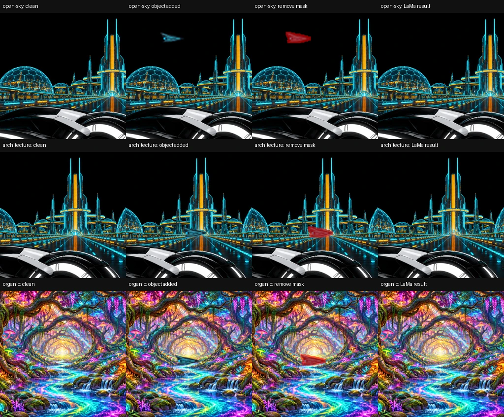
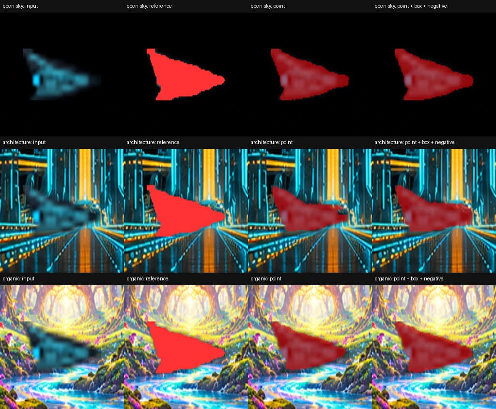
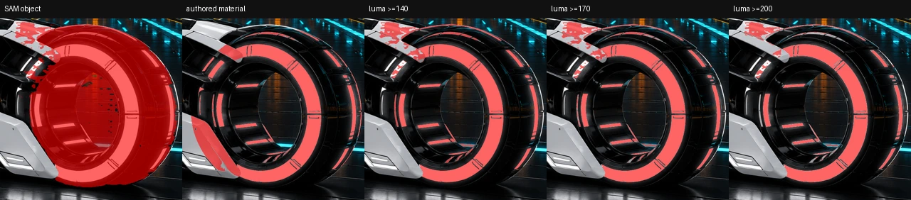
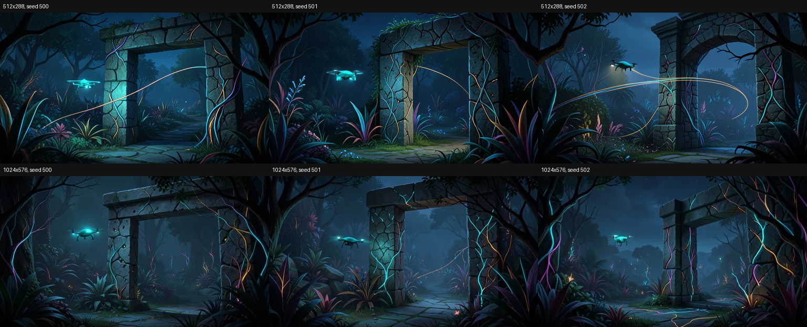
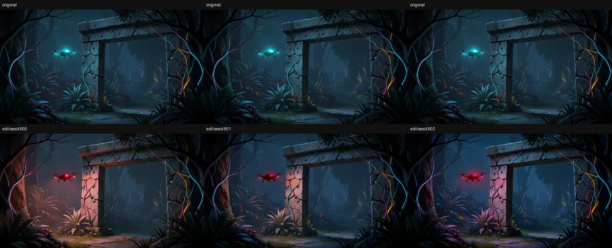
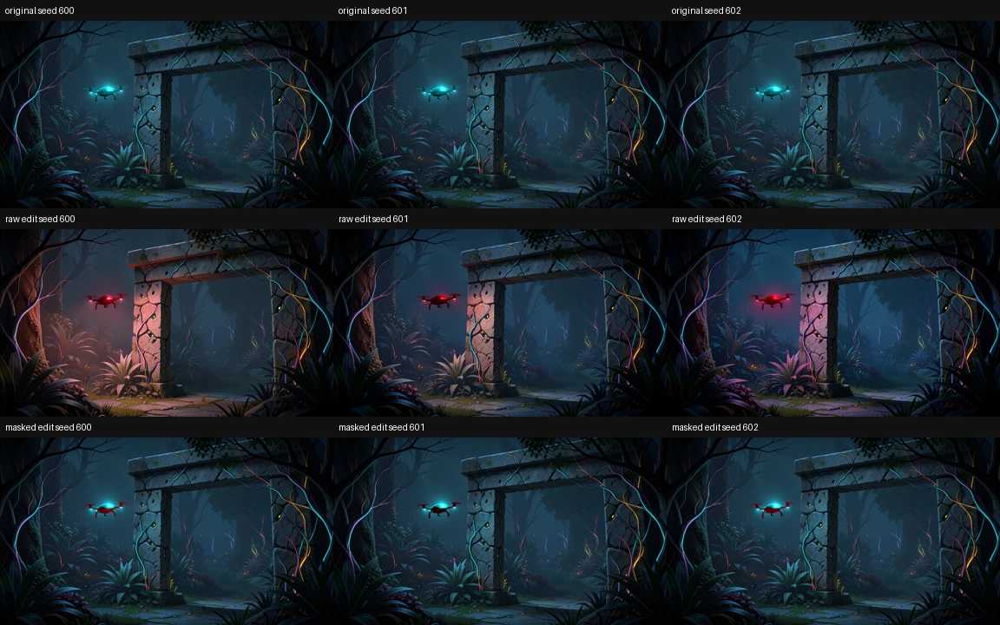

# KRE-00 — lokalne modele obrazu: Klein, SAM i LaMa

Data: **2026-11-10**. Kontynuacja [prób Qwen/VLM i narzędzi](KRE-00-2026-11-10-capabilities.md).
Stan: **w trakcie; KRE-01 nierozpoczęty**. Technicznie uruchomiono wszystkie
cztery role modeli, ale nie odebrano pełnego procesu ani jakości artworku.

## Wynik i ograniczenia

| Próba | Wynik |
| --- | --- |
| B-04 — generowanie | Klein 4B BF16 działa na RX 7800 XT. 512×288: mediana 1,40 s; 1024×576: 5,98 s po inicjalizacji. Kompozycja jest draftem, nie gotową sceną warstwową. |
| B-05 — edycja | Sam prompt zmienia też światła i otoczenie. Wariant z kodową maską kadłuba i ochroną świateł zachował resztę obrazu identycznie. Granice maski nadal wymagają QA. |
| B-06 — segmentacja | SAM 2.1 Tiny działa na GPU. Ciepła inferencja około 0,17 s; maski kontrolowanego obiektu mają IoU 0,79–0,93. Dodatkowe punkty/ramka nie zawsze poprawiają wynik. |
| B-07 — materiał światła | SAM + próg luminancji nie wystarcza do precyzyjnej selekcji. IoU około 0,63–0,66 względem istniejącej autorskiej maski; potrzebne korekty. |
| B-08 — uzupełnianie | LaMa ONNX działa na CPU, około 1,3–1,5 s dla 512×512. Dobre proste ciemne tło; utrata detalu i ciągłości na architekturze/organice. |

Nie są to budżety całego żądania w UI. Część wywołań korzysta z rozgrzanych
bibliotek, cache systemu i tych samych kształtów tensorów. B-09 ma dopiero
zmierzyć pełną sekwencję, w tym ładowanie i przełączenia.

## Rzeczywista instalacja i pochodzenie

Bez zmiany sterownika, globalnych pakietów Pythona, ApplicationRuntime,
MediaRuntime, audio, renderera ani tras UI. Środowiska i wagi znajdują się na D:
w ignorowanym `.local/kre00/`. Procesy pip i workerów otrzymują TMP/TEMP,
cache Hugging Face/Torch i MIOpen wewnątrz tego katalogu.

| Środowisko | Przypięty stan wykonanej próby |
| --- | --- |
| `venvs/onnx` | Python 3.12.6; onnxruntime 1.31.1, onnx 1.23.2, NumPy 2.5.4, Pillow 13.0.0 |
| `venvs/torch-rocm721` | PyTorch 2.9.1+rocm7.2.1, torchvision 0.24.1+rocm7.2.1, HIP 7.2.53211; transformers 5.22.2, accelerate 1.15.0, diffusers 0.42.1, safetensors 0.8.0 |

Wybrano konkretny udokumentowany stabilny stos AMD 7.2.1/Python 3.12 zamiast
nightly. To wybór próby, nie deklaracja najnowszej wersji ani zgodności każdej
biblioteki. Rzeczywisty test wykazał urządzenie **RX 7800 XT, gfx1101** i poprawne
mnożenie macierzy BF16 na GPU. `cuda:0` to nazwa interfejsu PyTorch używana też
przez backend ROCm; nie oznacza karty NVIDIA.

Modele, jeden wariant każdego:

| Model | Rewizja / format / warunki |
| --- | --- |
| `opencv/inpainting_lama` | `aee6d22f0a13e5e35af1c9a1c3afd62841fc6f3f`; `inpainting_lama_2025jan.onnx`, 92 591 623 B, SHA256 `7df918ac3921d3daf0aae1d219776cf0dc4e4935f035af81841b40adcf74fdf2`; Apache-2.0 według repozytorium OpenCV |
| `facebook/sam2.1-hiera-tiny` | Safetensors, 155 908 064 B; SHA256 `48c14467e5cf9e51870511feb72c89688e82dd74523142c0538b663e193ac2a7`; Apache-2.0; rewizja i konfiguracje w lock/provenance |
| `black-forest-labs/FLUX.2-klein-4B` | `e7b7dc27f91deacad38e78976d1f2b499d76a294`; BF16, enkoder tekstu + transformer + VAE, 14,88 GiB wybranych plików; Apache-2.0 |

[Locki, pochodzenie, raporty instalacji z URL/hashami i freeze](evidence/image-models-2026-11-10/environments/klein-environment-lock.json)
znajdują się w tym samym katalogu `environments/`. Dostęp do modeli był lokalny;
sieć służyła instalacji/pobraniu publicznych plików, bez płatnego API inferencji.
Biblioteki ROCm i zależności mają własne licencje; nie przenosimy licencji modelu
na cały stos.

## B-08 — LaMa i znane czyste tło

Próbki kontrolowane: istniejący samolot SVG z Digital Grid nałożono na dwa
wycinki Digital Grid i przeskalowane tło Forest. Samolot powiększono do 96 px
szerokości; nie jest to nowy zaakceptowany artwork ani test natywnego 4K.
Czysty obraz przed nałożeniem obiektu jest referencją. Maska usunięcia obejmuje
alfę sprite'a rozszerzoną filtrem 7×7. Oryginalne pliki pozostały identyczne.

Model ma wejścia float32 NCHW: obraz `[1,3,512,512]`, maska `[1,1,512,512]`.
Zastosowano BGR × 0,00392 zgodnie z przykładem OpenCV i binarną maskę. Jawny
provider: **CPUExecutionProvider**, 8 wątków intra-op / 1 inter-op. Nie raportujemy
tego jako przyspieszenia GPU. LaMa w tym wariancie nie ma losowego seeda;
wykonano trzy porównywalne powtórzenia każdego wejścia.

| Tło | Mediana inferencji, pierwsza seria | Mediana ponowienia po testach adaptera | MAE w masce: wejście → wynik, skala 0–255 |
| --- | --- | --- | --- |
| Ciemne niebo | 1,340 s | 1,505 s | 39,03 → 0,07 |
| Architektura i cienkie linie | 1,282 s | 1,496 s | 37,22 → 51,34 |
| Organiczne detale tła | 1,346 s | 1,493 s | 54,36 → 42,41 |

Pierwsze ładowanie sesji: 7,891 s. Cały pierwszy worker: 20,864 s. Szczyt RAM
procesu: 876 920 832 B (0,82 GiB working set), commit 1 545 306 112 B (1,44 GiB).
Po usunięciu sesji working set nadal wynosił około 0,65 GiB — `del` nie oznacza
całkowitego oddania pamięci przez wszystkie biblioteki; worker następnie zakończono.

Ocena: **częściowo**. Usunięcie obiektu działa; rekonstrukcja dokładnych
architektonicznych linii jest niewiarygodna i w tej próbce błąd nawet rośnie.
MAE nie jest samodzielną oceną percepcyjną, ale znane tło ujawnia różnice.
Wynik obejrzano; potrzebna ocena w zbliżeniu i w ruchu przed wykorzystaniem
jako odsłaniane tło. Piksele poza maską w dziewięciu wynikach były identyczne.
Kod narzuca tę ochronę przez składanie, nie polega na deklaracji modelu.

Dowody: [pierwsza seria](evidence/image-models-2026-11-10/lama-first/result.json),
[ponowienie z przetestowanym adapterem](evidence/image-models-2026-11-10/lama-validated/result.json).
Instalacje/pobieranie działały w tle części pomiarów; różnic czasów nie traktować
jako kontrolowanego porównania optymalizacji.

## B-06 — SAM: obiekt i korekta

Ten sam kontrolowany sprite, znana referencja alfa >127, trzy tła. To test
rejestracji i krawędzi konkretnego obiektu, nie dowód segmentacji dowolnych
organicznych form. Maska wyjściowa jest wybierana według najwyższej oceny SAM,
nie według później obliczonego IoU z referencją.

| Tło | Jeden punkt dodatni: IoU | Punkt + ramka + punkt ujemny: IoU |
| --- | --- | --- |
| Niebo | 0,927 | 0,919 |
| Architektura | 0,787 | 0,794 |
| Organiczne tło | 0,887 | 0,916 |

Każdy wariant miał trzy powtórzenia z zapisanymi seedami 400–402 i identycznymi
punktami. Pierwsza inferencja: 8,403 s; dalsze około 0,17 s. Ładowanie modelu:
0,851 s. Cały worker: 16,755 s. Torch: maks. przydzielone 1 023 838 208 B
(0,95 GiB), maks. zarezerwowane 1 457 520 640 B (1,36 GiB).

Ocena: **częściowo**. Korekta na organicznym tle pomaga, na niebie nieznacznie
pogarsza wynik. Na architekturze pozostają obce piksele/kontury. Nie obiecywać
automatycznie gotowej widoczności ani traktować oceny modelu jako potwierdzenia
jakości. Potrzebne wskazywanie obszaru i korekta maski w przyszłym UI.

Załadowano obrazową część oficjalnego checkpointu `sam2_video` przez `Sam2Model`,
zgodnie z przykładem karty modelu; Transformers wypisał ostrzeżenie o podzbiorze
architektury. Inferencja faktycznie działała. Nie uruchamiano segmentacji wideo.
Backend zgłaszał eksperymentalne zoptymalizowane attention dla AMD; nie włączano
tych opcji. [Pełne dane](evidence/image-models-2026-11-10/sam-1794302462019549500/result.json).

## B-07 — jasny materiał nie jest całą sylwetką

Na oryginalnym Digital Grid SAM wskazał obiekt koła. Osobny algorytm selekcji
wybierał jasne piksele wewnątrz tej maski. Referencją oceny jest istniejąca
autorska `visible-front-wheel.png` (R >127); nie użyto jej jako wejścia selekcji.
Wypróbowano trzy progi gamma-encoded luminancji Rec.709. Nie wybrano wyniku
automatycznie na podstawie referencji.

| Próg | Precyzja | Recall | IoU |
| --- | --- | --- | --- |
| 140 | 0,862 | 0,733 | 0,656 |
| 170 | 0,888 | 0,720 | 0,660 |
| 200 | 0,903 | 0,676 | 0,630 |

Ocena: **częściowo**. Ciemne szczeliny są zachowane, lecz SAM obejmuje też
fragmenty sąsiadującego kadłuba, a próg wybiera ich jasne odbicia. Część drobnego
materiału koła wypada z selekcji. Wymagane korekty obejmują styki koła z kadłubem,
cienki zewnętrzny obwód i refleksy. Nie zastępować maski materiału maską obiektu.
[Wyniki](evidence/image-models-2026-11-10/material-1794304096787464300/result.json).

## B-04 — Klein i ograniczenie pamięci

Tekst i obraz są wykonywane w oddzielnych procesach. Najpierw Qwen3 4B koduje
prompty do lokalnych safetensors, potem proces kończy się przed załadowaniem
transformera obrazu i VAE. Nie utrzymujemy równocześnie obu modeli 4B na GPU.

Prompty, seedy, wersja i SHA wytycznych oraz
[brief stosujący v1.7](../../../tools/artwork-creator/klein-authoring-brief.md)
są zapisane przy próbie. Zaplanowano ruch drona, role przyszłych warstw/masek,
liczne detale impulsów, przepływ silnych kolorów i blackout z niezależnymi
światłami. Bitmapa jest dopiero draftem do tego planu.

### Nieudana konfiguracja i porównana alternatywa

1. Filtr pobierania początkowo pominął `tokenizer/chat_template.jinja`.
   Pierwszy enkoder zakończył się błędem. Pobrano oryginalny szablon z tej samej
   rewizji, sprawdzono Git blob i SHA256; nie zastąpiono go własnym.
2. Standardowe attention działało przy 512×288, ale pierwsze 1024×576 zakończyło
   się `HIP out of memory` przy limicie procesu **85% karty = 13,59 GiB**.
   Komunikat wskazał 12,82 GiB przydzielone i kolejne żądanie 600 MiB.
   Nie zwiększono limitu kosztem budżetu systemu/renderera.
3. Porównano adapter dzielący wyłącznie wiersze zapytań na porcje 256. Każdy
   wiersz nadal uwzględnia wszystkie klucze/wartości. Działa w native math SDPA;
   nie wymaga eksperymentalnego Flash Attention. Testy CPU i BF16 GPU porównały
   wynik z pełną uwagą. Maski attention, causal, dropout, trening i równoległość
   wielu urządzeń są jawnie odrzucane, nie ignorowane.
4. W tej konfiguracji zakończyły się wszystkie sześć generacji i trzy edycje
   przy zachowanym limicie 85%.

To eksperymentalny adapter **lokalnego modelu**, osobny od rendererów i silnika
Infinite Zoom. Nie modyfikuje zainstalowanych plików Diffusers; podmienia punkt
dispatch tylko w swoim procesie. Wymaga testów po zmianie wersji biblioteki.

Dowody: [brak szablonu](evidence/image-models-2026-11-10/klein-1794303776760511800/encode-result.json),
[standardowe attention i OOM](evidence/image-models-2026-11-10/klein-1794304130372470100/generate-result.json),
[udana konfiguracja](evidence/image-models-2026-11-10/klein-1794304814602127700/generate-result.json).

| Rozmiar / operacja | Czas trzech przebiegów | Mediana |
| --- | --- | --- |
| 512×288, seedy 500–502 | 3,853 / 1,387 / 1,397 s | 1,397 s |
| 1024×576, seedy 500–502 | 6,853 / 5,983 / 5,969 s | 5,983 s |
| Edycja 1024×576, seedy 600–602 | 14,469 / 14,378 / 14,379 s | 14,379 s |

Wszystkie: BF16, cztery kroki, guidance 1,0, CPU Generator z zapisanym seedem.
Pomiar obejmuje inferencję i dekodowanie; nie obejmuje ładowania procesu/modelu.
Pierwsza generacja standardowego backendu 512×288 miała 48,417 s, kolejne
1,470 / 1,480 s. Nie usunięto kosztu inicjalizacji z raportu.
Seed nie gwarantuje identycznych pikseli między rozmiarami/wersjami/urządzeniami.

Ocena: **częściowo**, techniczne generowanie działa. Dron i plan bramy są
czytelne, ale skala/położenie nie są ścisłe, a liczba i rozmieszczenie detali
światła nie osiągają jeszcze wymagań briefu. Przy 512×288 powstały też odłączone
długie linie światła, mimo zakazu w promptcie. To naruszenie kryteriów artworku,
nie gotowe pasma materiału. Nie rozdzielono warstw, nie przygotowano kompletu
ukrytego tła i nie przeprowadzono odbioru w ruchu/zoomie, blackout/reveal ani
cykli kolorów. Żadna z tych bitmap nie jest produkcyjnie zaakceptowaną paczką.

## B-05 — sam prompt i twarda ochrona obszaru

Polecenie: tylko kadłub drona staje się czerwony; lampki i otoczenie bez zmian.
Surowa edycja zmieniła również lampki na czerwone oraz jasność/kolor roślin,
kamieni i oświetlenia. Poza szerokim planowanym obszarem drona zmieniono
87,4% / 88,0% / 93,3% pikseli o więcej niż 2 jednostki kanału. MAE wyniosło
11,567 / 6,126 / 8,345 (skala 0–255). To metryka względem przybliżonego prostokąta
z planu, nie precyzyjnej maski obiektu; obraz porównano także wizualnie.

Porównana alternatywa kodowa: SAM wskazuje dron na źródle, osobna selekcja
chroni jasny cyjan lampek, pozostały kadłub jest dozwoloną maską edycji.
Wynik Klein składany jest z oryginałem wyłącznie wewnątrz tej maski.
To świadomie ograniczona reguła tej próbki, nie uniwersalny segmentator lamp.

W trzech wariantach faktycznie zmieniono **1666 pikseli kadłuba**. Wszystkie
piksele poza maską kadłuba i wszystkie chronione światła pozostały identyczne.
Składanie/zapis: około 0,06 s. Granica między światłem, poświatą i kadłubem jest
heurystyczna; wymaga kontroli w zbliżeniu i korekty. Geometria samej propozycji
generatywnej nadal może się zmieniać wewnątrz maski.

[Maska kadłuba w zbliżeniu](evidence/image-models-2026-11-10/locked-edit-1794305188379295300/hull-review.webp),
[wyniki ochrony pikseli](evidence/image-models-2026-11-10/locked-edit-1794305188379295300/result.json).

Wniosek: funkcja edycji działa, ale warunek „nie zmieniaj tła/świateł” musi być
egzekwowany przez narzędzie i zaakceptowane maski. Sam prompt nie zapewnia
takiej ochrony. **Ocena końcowa B-05: częściowo** do czasu odbioru granic masek.

## Pamięć i czas całej próby Klein

Enkoder: wcześniejsza udana próba — ładowanie 4,725 s, kodowanie/zapis promptu
generacji 2,403 s (303 tokeny), edycji 0,175 s (140 tokenów); limit 512, bez
cichego obcięcia. Cały worker 11,957 s. Maksimum alokacji Torch 7,83 GiB;
szczyt RAM working set 8,11 GiB. To osobny checkpoint Qwen3 używany przez Klein,
nie działający jednocześnie konwersacyjny Qwen3.5 z B-01.

W udanej serii obrazowej:

| Pole | Wynik |
| --- | --- |
| Załadowanie transformera + VAE | 7,847 s |
| Cały worker obrazu, 6 generacji + 3 edycje | 81,763 s |
| Maksimum przydzielone przez allocator Torch | 11 609 003 008 B = 10,81 GiB |
| Maksimum zarezerwowane przez allocator Torch | 14 130 610 176 B = 13,16 GiB |
| RAM procesu: peak working set | 8 323 964 928 B = 7,75 GiB |
| RAM procesu: peak commit | 18 820 222 976 B = 17,53 GiB |

Allocator Torch nie jest pełnym pomiarem VRAM sterownika/Windowsa. Migawka
WDDM podczas wcześniejszej próby nie pokazywała całego zużycia HIP, więc nie
użyto jej jako dowodu małego zapotrzebowania. Własny worker kończy się po
operacji; nie zakładać, że `empty_cache()` zwalnia wszystkie konteksty i żywe
referencje. Nie sprawdzono jeszcze łącznego budżetu z działającym rendererem
i muzyką ani komfortu wielogodzinnej pracy w aplikacji.

## Kod, dowody i testy

Nowe narzędzia: `image_environment.py`, `inspect_image_runtime.py`,
`lama-fixture.mjs`, `lama_probe.py`, `sam_probe.py`, `material_probe.py`,
`klein_probe.py`, `bounded_attention.py`, `image_ops.py`, `locked_edit_probe.py`
oraz brief i testy. Rozszerzono pomocnicze pobieranie w `kre00.py`: bezpieczny
HTTP Range, walidacja zakresu, zastąpienie odpowiedzią 200 zamiast błędnego
dopisania i końcowy SHA256. Wznowiony plik Klein przeszedł hash. Przerwano
tylko własne pobieranie, nie inferencję; to **nie** zalicza B-10.

Wagi i pełne PNG pozostają w `.local/kre00/`; przy każdym archiwum wyników
znajduje się `inventory.json` ze ścieżkami, rozmiarami i hashami. W repozytorium
zapisano małe JSON-y, wersje, logi i porównania. Obrazy wyników nie nadpisują
zaakceptowanych scen ani wcześniejszych dobrych prób.

Testy: **24/24 OK** — 4 Node, 12 lekkich testów Python, 5 kontraktów pikseli
w środowisku ONNX, 3 testy attention w środowisku Torch (w tym BF16 na GPU).
[Polecenia i wyjście](evidence/image-models-2026-11-10/tests.json).
Sprawdzono kolory RGB/BGR, rejestrację i skończoność wyników, zachowanie tła
i chronionych świateł, ciemne szczeliny, porównanie attention i bezpieczne
wznawianie. `git diff --check` bez błędów. Nie uruchamiano całego monorepo/builda
UI, ponieważ aplikacja nie była zmieniana. Rzeczywiste serie modeli są
dodatkowym dowodem działania, a nie testami wymagającymi wag w zwykłym CI.

## Rekomendacja robocza i dalsze kroki

Kandydat na lokalny stos: Qwen3.5/Vulkan + Klein/BF16 z ograniczoną pamięciowo
uwagą + SAM 2.1 Tiny/ROCm + LaMa/CPU dla prostych teł. **To rekomendacja
do dalszych prób, nie ostateczny odbiór zestawu.** Nie zostawiać wszystkich
modeli na GPU. Maski, ochrona niezmienianych obszarów i zgłoszenie błędu
muszą być obowiązkami kodu; model pomaga przygotować propozycję.

W chwili tego pomiaru pozostawały B-09: pełna sekwencja i przełączenia;
B-10: anulowanie inferencji, restart i odzyskanie pamięci; B-11: rzeczywisty
podgląd z budżetem aplikacji. **Aktualizacja:** wykonano je w
[kolejnej serii B-09–B-11](KRE-00-2026-11-10-sequence-qa.md).
Nie zamknięto jakości złożonych masek/tła, odbioru w ruchu/zoomie ani uzgodnienia
użytecznych budżetów czasu/interwencji użytkownika. Nie przechodzimy do KRE-01
na podstawie samych udanych importów lub atrakcyjnego statycznego draftu.

Źródła techniczne: [AMD: instalacja 7.2.1](https://rocm.docs.amd.com/projects/radeon-ryzen/en/latest/docs/install/installrad/windows/install-pytorch.html),
[OpenCV LaMa i preprocessing](https://huggingface.co/opencv/inpainting_lama/blob/aee6d22f0a13e5e35af1c9a1c3afd62841fc6f3f/lama.py),
[SAM i punkty/ramki](https://huggingface.co/facebook/sam2.1-hiera-tiny),
[Klein 4B](https://huggingface.co/black-forest-labs/FLUX.2-klein-4B),
[MIOpen cache](https://rocm.docs.amd.com/projects/MIOpen/en/docs-7.1.1/conceptual/tuningdb.html).
O wynikach tego komputera stanowią powyższe lokalne pomiary, nie cudze benchmarki.
