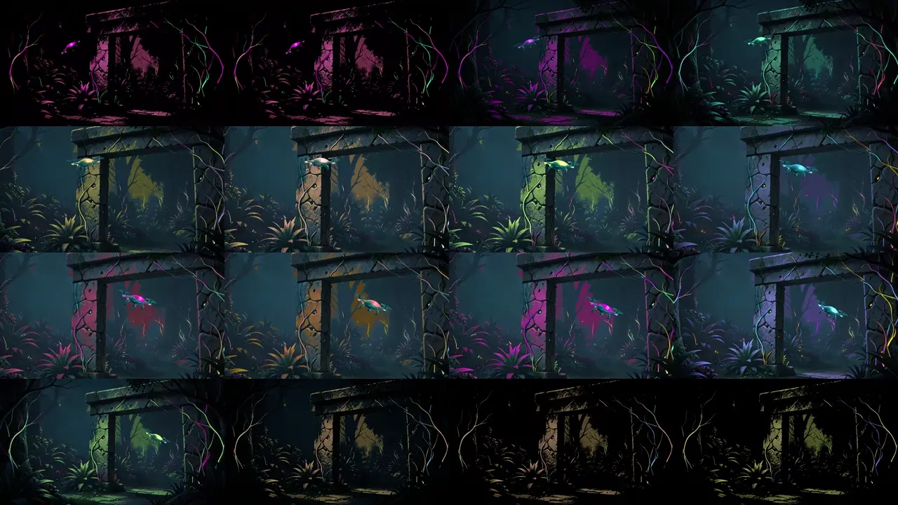

# KRE-00 — sekwencja, anulowanie i podgląd, 2026-11-10

**B-09–B-11 wykonano technicznie. KRE-00 pozostaje do korekty, bez odbioru jakościowego.**
Lokalny stos z [poprzedniego raportu](KRE-00-2026-11-10-image-models.md)
potrafi wykonać całą ograniczoną receptę. Draft nie spełnia wymagań gotowego
artworku: maski materiałów, zasłanianie obiektu i propagacja światła wymagają pracy.
Nie rozpoczęto KRE-01 ani integracji kreatora z produkcyjnym UI.

## B-09: rzeczywiste przełączenia modeli

Qwen wywołał `queuePilot` trzy razy; narzędzie zapisało trzy zadania ze statusem
`queued`. Następnie serwer LLM zakończono, a każde zadanie wykonało osobne
procesy: enkoder Qwen3 → Klein → SAM/selektory masek → LaMa/kompozycja tła.
Każdy worker naprawdę przeliczył wynik. Powtórzenia używają tej samej recepty,
seed 500 i 1024×576; nie dowodzą jakości dla dowolnego promptu.

| Próba | Pełny łańcuch workerów |
| --- | ---: |
| 1 | 62,188 s |
| 2 | 59,844 s |
| 3 | 59,583 s |
| Mediana | **59,844 s** |

Czasy obejmują start/ładowanie kolejnych workerów, ale wyłączają wspólne,
wcześniejsze planowanie przez LLM i przygotowanie podglądu. Cache systemu
operacyjnego mógł być ciepły. Przebiegi są identyczne pikselowo w tym środowisku.
Punkt/ramka drona pochodzą z ręcznie obejrzanego obrazu; nie jest to automatyczny
lokalizator. Maska świateł używa progów kolorów. Rekonstrukcja używa wycinka
512×512, a kompozycja zachowuje pozostałe piksele źródła.

Dowód: `sequence-1794306220653822400/result.json`; plany:
`llm-1794306163480690300`. Pomiary alokatora modeli z B-04–B-08 pozostają
aktualnym dowodem pamięci; ta seria nie mierzy dokładnego szczytu VRAM całego
systemu. Zakończenie procesów zapobiega ich równoczesnemu utrzymywaniu na GPU.

## B-10: przerwana inferencja i ponowienie

Własny worker Klein przerwano dopiero po zapisaniu pierwszego rzeczywistego
kroku dyfuzji, po 10,929 s. `terminate` i `wait` trwały około 0,001 s;
proces zakończył się kodem 1, bez gotowego PNG. Ponowienie w nowym katalogu
zakończyło się poprawnie po 17,266 s. Hash obrazu odpowiada referencji seed 500;
obrazy i embeddingi źródłowe zachowały hashe przed/po.

To dowód przerwania i odzyskania zasobów wystarczających do kolejnego zadania
na tym stosie, nie pomiar zerowej globalnej VRAM ani implementacja anulowania
w docelowym API/kolejce. Nie przerwano obcych procesów. Dowód:
`cancel-1794306558161444400/result.json`.

## B-11: istniejący renderer, ruch i audio

Niepublikowana paczka diagnostyczna używa istniejącego parsera i renderera.
Nie zmieniono silnika, MediaRuntime, ApplicationRuntime ani `/animations`.
Scena zawiera tło po LaMa, wydzielonego drona, niezależne maski świateł,
12-sekundowy lot po krzywej, blackout/reveal i zoom. Brief odwołuje się do
wspólnych wytycznych authoringu v1.7; niespełnione wymagania są jawne.

Przeglądarka użyła RX 7800 XT przez ANGLE/D3D11. Zaliczone: 840 kroków
symulacji po 1/60 s, jeden canvas, brak dodatkowego audio, zamrożenie pauzy,
reset stanu/kamery i pikseli, pełne pokrycie oraz format pionowy/szeroki.
Reset: `readPixels` — 0 zmienionych kanałów; brak wyjątków przeglądarki.
Szacunek tekstur i buforów renderera: łącznie 12,60 MiB przy budżecie 256 MiB;
nie jest to pomiar fizycznej VRAM.

Nagranie WebM ma 1024×576, 15,566 s i 742 zakodowane klatki. 840 kroków
symulacji **nie oznacza** pomiaru wydajności 60 FPS. Obejrzano zapisane klatki
i arkusz klatek z nagrania, w tym lot, blackout i zoom; nie wykonano pełnego
odbioru artystycznego filmu.

[Pełne lokalne nagranie](../../../.local/kre00/runs/sequence-1794306220653822400/job-0/browser-qa-1794307326877/motion.webm)
pozostaje poza Gitem. Przed czyszczeniem `.local` zachować archiwum plików
wskazanych w `artifact-inventory.json`; kopie raportowe zawierają hashe,
logi, manifest i powyższy arkusz, nie wszystkie duże obrazy/nagrania/wagi.

Osobno przeszedł istniejący test integracyjny aplikacji:
`node tests/infinite-zoom-integration.browser.mjs` z `apps/ui`, kod 0.
Sprawdza gotowość przed audio, anulowanie przygotowania, ponowne użycie grafu,
pauzę/koniec/następny utwór, tryby/Escape/focus, przejście, reset i izolację
błędu wizualizacji od muzyki; także blokadę pierwszego Play przy błędzie
ładowania i jawne ponowienie. Test używa lokalnej atrapy API/autoryzacji.
Nowa paczka była w osobnym fixture — ten wynik nie oznacza gotowego kreatora w UI.

Zachowano nieudane próby: uruchomienie Chromium w sandboxie oraz pierwotny
test porównujący napisy PNG. Przy resecie pojedynczy kanał PNG różnił się o 1;
porównanie rzeczywistych pikseli WebGL i logicznego stanu przechodzi dokładnie.
Nie zmieniano renderera w celu zaliczenia próby.

## Jakość i warunek dalszej pracy

- Maska środowiska wybiera zbyt duże powierzchnie kamienia/roślin i drobny szum.
  Blackout ujawnia kolorowe plamy zamiast precyzyjnych, licznych detali materiału.
- Brakuje osobnej przedniej warstwy filaru: dron przelatuje przed geometrią,
  za którą zgodnie z briefem powinien znikać.
- Zmiana koloru/impuls jest globalna dla maski; brak wymaganej przestrzennej
  propagacji. To osobna luka możliwości istniejących operatorów, nie zakończony
  etap produkcji artworku. W tym zadaniu nie rozszerzano silnika.
- Kontury obiektu i tło po usunięciu poświaty wymagają oceny i korekt w ruchu/zoomie.
  Natywne źródło ma 1024×576, nie 4K. Brak nowego portalu i testu zoomThrough.

Kandydat techniczny pozostaje Qwen/Vulkan + Klein/BF16 z ograniczeniem attention
+ SAM/ROCm + LaMa/CPU. Dalszy krok KRE-00: poprawić selekcję materiału,
warstwy zasłaniania i backing oraz oddzielnie rozstrzygnąć brak propagacji
światła. Dopiero ponowna ocena ruchu/zoomu i uzgodnienie potrzebnych ręcznych
korekt pozwolą odebrać etap. Dzisiejsze wyniki nie dają podstaw do ukrycia tych
ograniczeń za interfejsem KRE-01.

## Pliki i weryfikacja

Nowe narzędzia: `sequence_probe.py`, `sequence_image_tools.py`,
`cancellation_probe.py`, `preview-package.mjs`, `preview-browser.mjs`,
`preview.browser.mjs`; rozszerzenia `kre00.py` i `klein_probe.py`.
Pozostałe zmiany dotyczą instrukcji, raportów i izolowanego katalogu dowodów.
Źródła wykonanych narzędzi i wyniki testów zapisano w
[evidence/sequence-qa-2026-11-10](evidence/sequence-qa-2026-11-10).
Ponowione testy narzędzi: **24/24** (4 Node, 12 obsługi benchmarku/pobierania,
5 operacji obrazu, 3 attention, w tym BF16 na GPU). Kontrola składni nowych
workerów Python i podglądu JavaScript oraz `git diff --check` bez błędów.
Seria B-09, anulowanie/restart, podgląd i test integracyjny są osobnymi
rzeczywistymi próbami. Nie uruchamiano całego zestawu monorepo.
Nie wykonano commitów, publikacji ani zmian źródeł aplikacji.
