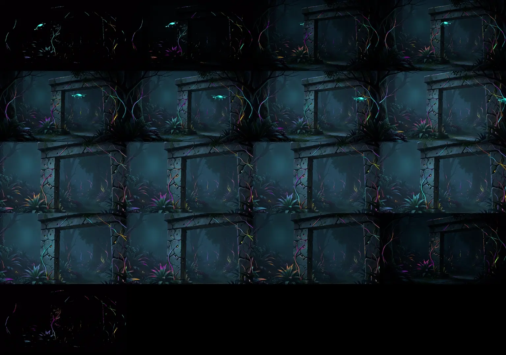

# KRE-00 — korekta pilota i ponowna weryfikacja

Data: **2026-11-13**. Końcowa paczka diagnostyczna: **0.0.3**.
Korekta pilota została wykonana i zweryfikowana technicznie. Na moment tej próby
KRE-00 pozostawał do odbioru; później zakończono pomiar przy aplikacji i
[zamknięto benchmark](KRE-00-2026-11-13-closure.md). Nie rozpoczęto KRE-01 ani kreatora w UI.
Wyniki zastępują ocenę pilota z [10 listopada](KRE-00-2026-11-10-sequence-qa.md),
z zachowaniem tamtych prób i ich ograniczeń.

## Co zmieniono

- `correct-pilot.mjs` tworzy nowy katalog operacji, sprawdza hash źródła i nie
  nadpisuje poprzednich wyników. Recepta `pilot-correction.json` zapisuje ręcznie
  dobrane punkty SAM, obszar usunięcia poświaty i prowadnice materiałów.
- SAM wydziela cały lewy filar. `occlusionMaskAssetId` zasłania kadłub i lampki
  drona w nieruchomych współrzędnych sceny, także przy całkowitym zaciemnieniu.
  Nie jest potrzebna dodatkowa warstwa obrazu przed dronem.
- LaMa uzupełnia tło w masce obejmującej obiekt i jego wypaloną poświatę.
  Pierwsza korekta pozostawiała fragmenty wirników; powiększenie obszaru
  usunięcia usunęło je w ocenionych próbkach. **13 813 pikseli** jest objętych
  wypełnieniem; piksele poza maską pozostają identyczne ze źródłem.
- Selekcja światła odrzuca płaskie niebieskie powierzchnie, wykorzystuje chromę,
  lokalny kontrast i prowadnice istniejących lian. Trzy rozłączne grupy obejmują
  **1741 / 2557 / 1943 piksele** materiału. To liczba pikseli, nie liczba
  zaakceptowanych detali; nie dowodzi spełnienia liczbowych zamiarów briefu.
- Osobna mapa opóźnienia opisuje odległość wzdłuż autorskich prowadnic. Okres
  koloru to 8 s, czas propagacji 3 s, okresy impulsów grup 6/8/11 s.
- Dron leci przez 16 s, za lewym filarem, następnie przed dalszym ogrodem i prawą
  stroną bramy, poza prawą krawędź. Wersja 0.0.2 znikała jeszcze w otworze
  bramy po zakończeniu jednorazowego lotu; 0.0.3 usuwa ten błąd przez trasę.
  Test obejmuje cały obrys obu wirników przed końcem podróży warstwy.

Wykorzystano istniejące `colorShift.delayMapAssetId`, `travelSeconds` i
`occlusionMaskAssetId`. Stwierdzenie starego raportu, że brak propagacji wymaga
rozszerzenia operatorów, było nieprawidłowe. **Nie zmieniono silnika**, audio,
ApplicationRuntime, MediaRuntime ani tras UI. Wytyczne authoringu **v1.7** są
wspólnym źródłem zasad i są wskazane w nowym briefie. Źródło ma **1024×576**;
logiczny canvas 3840×2160 nie oznacza natywnego 4K.

## Dowody i wynik techniczny

Końcowy run: `.local/kre00/runs/correction-1794554290558`.
Podgląd: `browser-qa-1794554710636` w tym katalogu.
[Archiwum dowodów](evidence/correction-final-2026-11-13/artifact-inventory.json)
zawiera hashe artefaktów i źródeł narzędzi; małe maski, manifest, brief i wyniki
są zachowane obok. Kopia briefu w archiwum ma dostosowany odnośnik względny.
Wcześniejsze dowody `correction-2026-11-13` dotyczą **0.0.2**, nie wersji końcowej.

| Sprawdzenie | Wynik |
| --- | --- |
| Renderer | RX 7800 XT, ANGLE/D3D11, WebGL2; RGBA16F |
| Symulacja | 1440 kroków po 1/60 s, czyli 24 s; dodatkowa izolowana próba przepływu 4 s |
| Przesłanianie | Klatka 149: 234 piksele maski drona nakładają się na filar; 0 zmian wnętrza filaru przy włączeniu drona, 2683 zmienione piksele poza wnętrzem |
| Blackout | 582 595 całkowicie czarnych pikseli, 7220 pikseli światła powyżej przyjętego progu w badanej klatce; pełna alfa |
| Propagacja | Po 1 s zmiana bliskiego punktu 121 jednostek kanału, dalekiego 0; po 4 s dalekiego 202, przy wyłączonym glow i nieruchomej kamerze |
| Pauza | Bez kroków symulacji kolejne renderowania zachowują obraz |
| Reset | Identyczny stan logiczny i kamera; 0 zmienionych kanałów `readPixels` |
| Pokrycie | Pełna alfa w próbkach blackout/reveal i po resize do 450×800 oraz 1400×600 |
| Integralność | Obraz źródłowy i dwie wejściowe maski mają identyczne hashe przed/po |

Źródła: [wynik przeglądarki](evidence/correction-final-2026-11-13/browser-result.json),
[wynik korekty](evidence/correction-final-2026-11-13/correction-result.json).

[Nagranie lokalne](../../../.local/kre00/runs/correction-1794554290558/browser-qa-1794554710636/motion.webm)
ma 1024×576, **25,746 s**, 1343 zakodowane klatki i około 6 MB.
Liczba kroków symulacji nie stanowi benchmarku 60 FPS. Duże źródła i film
pozostają poza Gitem; zachować je razem z inwentarzem przed czyszczeniem `.local`.



## Ocena wizualna i granice odbioru

Obejrzano podgląd masek, klatki w pełnej rozdzielczości oraz próbki z całego
nagrania. Dodatkowo oceniono gęstsze serie co 0,25 s:
[przejście za filarem](evidence/correction-final-2026-11-13/crossing-detail.webp)
i [dalszy lot ku krawędzi](evidence/correction-final-2026-11-13/exit-detail.webp).
To przegląd klatek rzeczywistego ruchu, nie deklaracja obejrzenia każdej klatki
filmu ani końcowej akceptacji artystycznej przez użytkownika.

- Sylwetka stopniowo znika za lewym filarem i pojawia się po jego drugiej stronie.
  Nie zaobserwowano kopii drona w ocenionym tle; po korekcie trasy obiekt opuszcza
  kadr zamiast znikać w środku bramy. Nie wykonano nowej segmentacji całej
  roślinności: przelot przed prawą stroną sceny jest świadomym porządkiem warstw.
- Materiały są znacznie precyzyjniejsze niż poprzednie duże plamy. Cienkie liany
  i część liści zachowują kolor w czerni; zmiany cyjan/magenta/bursztyn są
  dostrzegalne na próbkach pełnego kadru i zoomu. Filar nadal zawiera drobne,
  ziarniste zaznaczenia. Nie potwierdzono, że każde z nich jest zamierzonym
  materiałem światła; ta selekcja wymaga decyzji autora i lokalnego retuszu maski.
- Mapa opóźnienia podąża za prowadnicami, ale poza nimi materiał korzysta z
  najbliższej prowadnicy. Na styku prowadnic i odgałęzień możliwe są różnice
  fazy; nie jest to uniwersalny algorytm topologii żyłek/liści.
- Przy odsłanianiu nie zaobserwowano dużych skoków jasności w ocenionych próbkach.
  Pozostaje szczegółowa ocena cieni w ruchu oraz osobny odbiór trybu RGBA8.
- Binarna maska drona i SAM filaru nadal wymagają oględzin cienkich krawędzi
  przy większych zbliżeniach. Uzupełnienie nieba przez LaMa jest miękkie;
  poprawność na tym małym obszarze nie oznacza odbioru rekonstrukcji architektury.

## Pomiary i rekomendacja dalszego stosu

Zachować do kolejnych prób **Qwen/Vulkan + Klein/BF16 z ograniczonym attention
+ SAM/ROCm + LaMa/CPU**, w przypiętych środowiskach opisanych w raporcie
[modeli obrazu](KRE-00-2026-11-10-image-models.md). Nie instalowano nowych wag
ani zależności. ComfyUI nie jest zależnością wykonanego procesu.

Końcowa korekta już istniejącego obrazu: worker SAM **18,290 s**, worker LaMa
**10,364 s** wraz ze startem procesów. To pojedynczy przebieg po awarii, nie
mediana ani nowy pomiar całego prompt → paczka. Historyczne 59,844 s dotyczy
poprzedniej recepty B-09 i nie jest czasem końcowego pilota 0.0.3.
SAM raportuje około 0,87 GiB maksymalnej alokacji i 1,29 GiB rezerwacji Torch.
Diagnostyka renderera szacuje około **14,85 MiB** tekstur i targetu przy 1400×600.
Nie są to pomiary globalnego szczytu fizycznej VRAM ani jednoczesnej pracy
Klein i produkcyjnej aplikacji. Taki budżet wymaga osobnej próby z telemetrią.

Rekomendacja procesu MVP: jedna ciężka operacja GPU naraz; zakończenie procesu
modelu przed uruchomieniem następnego. Zaplanować wskazywanie punktów/obszarów,
korektę maski pędzlem, prowadnice przepływu i obowiązkowy podgląd ruchu.
Nie obiecywać autonomicznej selekcji materiałów ani dowolnych stylów.
Przed przejściem bramki KRE-00 trzeba ocenić użyteczność takiego zakresu
interwencji i domknąć wskazane granice jakości oraz budżet przy aplikacji.

## Testy, awarie i zakres plików

[Zapis weryfikacji](evidence/correction-final-2026-11-13/validation.json):

```powershell
node --test tools/artwork-creator/benchmark-tools.test.mjs tools/artwork-creator/pilot-materials.test.mjs
py -B -m unittest discover -s tools/artwork-creator -p test_kre00.py -q
.local/kre00/venvs/onnx/Scripts/python.exe -B -m unittest discover -s tools/artwork-creator -p test_image_ops.py -q
# z apps/ui, ponowiony po przerwie w zasilaniu:
node tests/infinite-zoom-integration.browser.mjs
```

**8 Node + 12 Python + 5 operacji obrazu = 25/25**. Osobno przechodzą końcowy
podgląd WebGL oraz test integracyjny: readiness/anulowanie, ponowne użycie grafu,
pauza/koniec/następny utwór, tryby, przejście, Reset, izolacja błędu wizualizacji
i blokada pierwszego Play przy błędzie zasobów z jawnym ponowieniem.
Integracja używa istniejącego fixture API/autoryzacji, nie nowego kreatora w UI.

Końcowa [kontrola integralności](evidence/correction-final-2026-11-13/integrity-check.json)
potwierdziła 45 artefaktów, 12 hashy źródeł/wytycznych, wymiary wszystkich
10 assetów i dokładną zgodność 576 011 pikseli tła poza maską wypełnienia.
`git diff --check` przeszedł bez błędów.

Pierwsza próba GPU w sandboxie zakończyła się `miopenStatusUnknownError`;
ponowienie poza nim zadziałało. Chromium także wymagał ponowienia poza sandboxem.
Zachowano lokalne nieudane/przejściowe próby. Kontynuacja po awarii prądu
ponowiła test integracyjny; jego poprzedniego wyniku nie uznano za zaliczenie.

Zmiany kodu dotyczą wyłącznie `tools/artwork-creator/`: recepty korekt, operacji
materiałów, workerów SAM/LaMa, budowania paczki, podglądu, archiwizacji i testów.
Dokumentacja i dowody są w `planning/artwork-creator/`. Nie uruchamiano całego
monorepo ani ponownego benchmarku wszystkich modeli. Nie wykonano commitów,
publikacji, migracji bazy ani zmian zaakceptowanych scen aplikacji.
