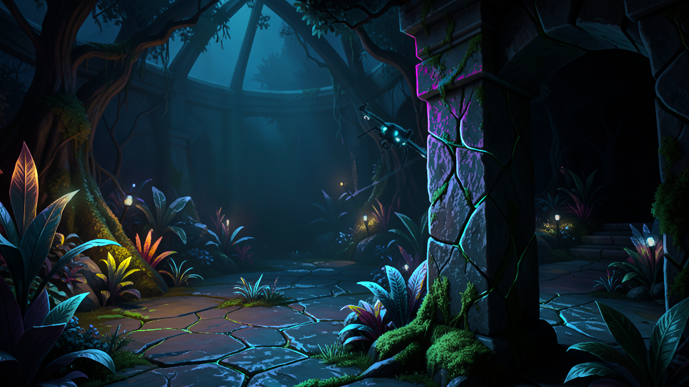

# KRE-03 — kompletna paczka przez API, 2026-11-13

**KRE-03 wdrożony i sprawdzony technicznie.** Powstała kompletna scena pilota
1024×576 przez zarejestrowane operacje API, wraz z pochodzeniem, rekonstrukcją
tła, warstwami, maskami, mapami wpływu/opóźnienia, ruchem i niezależnym światłem.
Paczka działa po zatrzymaniu API i procesów modeli. Zapisano nagranie i wykonano
przegląd sekwencji kadrów rzeczywistego ruchu/zoomu. To developerowy pilot
o opisanych granicach jakości, bez publikacji do biblioteki i bez odbioru
estetycznego przez użytkownika. Nie rozpoczęto KRE-04.

## Zakres wdrożenia

Pliki implementacji i pierwszy techniczny fixture opisuje
[raport wstępny](KRE-03-2026-11-13.md). Końcowy zakres:

- Koordynator `apps/artwork-worker/production-client.mjs`: wersjonowane plany,
  trwały checkpoint, idempotentne zlecenia, jawne rewizje, wykrywanie konfliktów,
  odzyskanie po utraconej odpowiedzi, eksport z kontrolą SHA256. Pełne
  pochodzenie zadań pobiera stronicowo. Starsze własne znaczniki operacji
  pozostają w historii rewizji, a aktualny snapshot mieści się w limicie
  100 decyzji; nie usuwa decyzji użytkownika.
- `tool-registry.ts`, deklaracje kontraktów, `worker.py`: pięć nowych
  zarejestrowanych narzędzi `createColorPlate`, `createMask`, `composeMasks`,
  `registerMap`, `inspectSelection`. `deriveLightSelection` ma opcjonalną
  selekcję lokalnego kontrastu materiału (`detailRadius`, `detailContrast`),
  przy zachowaniu dotychczasowego działania bez tych parametrów. Nie jest to
  semantyczne rozpoznawanie materiału ani nowy efekt silnika.
- `artwork-jobs.service.ts`: wszystkie maski muszą pasować do konkretnego obrazu;
  tylko jawny transfer `registerMap` tworzy nową rejestrację pełnego kadru 16:9.
- `build-package.mjs`: istniejący parser silnika, tylko używane zasoby, walidacja
  masek i grup podglądu, limit tekstur 192 MiB, raport wymiarów i brak publikacji.
- `artwork-production-pilot.cjs`: rzeczywiste API/usługi i oddzielny worker na
  izolowanej bazie testowej; kontrolowany strażnik autoryzacji zamiast testu JWT.
  `worker.ts` pozwala zmienić interwał pollingu bez zmiany domyślnego 5 s.
- `production-preview*.mjs`: jeden istniejący renderer, stałe kroki 1/60 s,
  kontrolowane sygnały audio, nagranie, kadry oraz pomiary. Bez zmian w runtime
  aplikacji, odtwarzaczu muzyki, routingu i zaakceptowanych scenach.
- [Brief v1.7 i zastosowanie do źródła](../pilots/gate-drone/authoring-brief.md),
  [recepta i historia korekt](../pilots/gate-drone/recipe.json), testy i dokumentacja.

## Rzeczywista produkcja i korekty

Po sygnale użytkownika bramka dopuściła inferencję. Klein wygenerował źródło
1024×576 w około 39,4 s. Zapisany końcowy odczyt zadania: około 17,5 GiB zapasu
commit, 22,2 GiB wolnego RAM oraz 14,6 GiB dostępnego budżetu VRAM.
Nie jest to pomiar szczytowego użycia. SAM wykonał selekcje drona i filara;
LaMa odtworzył tło. Nie omijano bramki, nie zmieniano ustawień pamięci systemu.

Obraz nie odtworzył dokładnie planowanej pozycji: dron jest bliżej x=34,5%,
y=42,5% i ma około 14% szerokości kadru. Selekcję dopasowano do rzeczywistego
obrazu. Po generacji przez API poprawiono:

1. Dwa małe drony w tle oraz kopię głównego drona usunięto przez maski i LaMa.
2. Pierwsze uzupełnienie pozostawiało jasną plamę lampy. `backing-v2` wykorzystuje
   większy obszar rekonstrukcji; końcowe kadry ruchu/zoomu nie pokazują tej plamy.
3. Szerokie selekcje obejmowały jasny dach. Ograniczono obszar i wybrano lokalne
   detale jasności zamiast szerokich powierzchni. Liściom, kamieniu i mchowi
   odpowiadają rzeczywiste żyłki, szczeliny i faktura.
4. Podział na pionowe pasy, a potem wielokąty, przecinał materiał. Końcowe grupy
   v5 wynikają z rodzin barw materiału, bez prostych szwów i uciętych liści.
   Stare nazwy identyfikatorów `west/middle/east` zachowano dla ciągłości testu.
5. Długa seria korekt ujawniła limit decyzji snapshotu. Poprawiono koordynator
   bez podnoszenia limitu API; wznowiono istniejące zadanie bez ponownej inferencji.

Wszystkie obrazy, maski i manifesty wynikowe utworzyły narzędzia API. Zmieniano
receptę wejściową, nie piksele ani manifest wynikowy. Historyczne operacje
pozostają w projekcie: **99 zakończonych zadań i 99 artefaktów**. Nie oznacza
to 99 inferencji — większość to małe operacje CPU i raporty. Końcowy manifest
używa 17 zasobów, 7 warstw i około 12,4 MiB tekstur według estymatora paczki.
Źródła 1024×576, neutralne pokrycie 16×9; canvas 3840×2160 nie jest natywnym 4K.

## Dowody ruchu, zoomu i świateł

[Końcowy pomiar WebGL](KRE-03-2026-11-13/pilot-webgl.json),
[pochodzenie i SHA256 nagrania](KRE-03-2026-11-13/pilot-summary.json),
[manifest](KRE-03-2026-11-13/pilot-manifest.json).
Nagranie: `.local/kre03/runs/pilot-1794572870608/bundle-a46639a94e15ec44/qa-1794580645795/motion.webm`
(10 526 613 bajtów). Powstało z rzeczywistego renderera WebGL na RX 7800 XT,
1920 klatek, 32 s symulacji. Nie deklarujemy na tej podstawie wydajności FPS.

Przejrzano kolejne kadry początku, odsłaniania, przelotu, przejścia za filarem,
wyjścia, zoomu, wygaszania i Resetu oraz próbki propagacji koloru. Nie ograniczono
oceny do zmienionych pikseli lub nieruchomego widoku.

| Warunek | Wynik |
| --- | --- |
| Własny ruch drona | Pełny łuk 24 s z przyspieszaniem/zwalnianiem, obrotem i wyjściem z kadru; wspólny punkt obrotu kadłuba/lamp |
| Tło odsłaniane przez ruch | W przejrzanej sekwencji brak kopii drona, jasnej plamy i pustych miejsc |
| Filar | Statyczna maska przesłania kadłub i lampy; w próbie 120 pikseli oczekiwanego nakładania, 0 zmienionych pikseli we wnętrzu filara, 2829 widocznych poza nim |
| Materiałowe światło | Trzy grupy: 5714, 31105 i 578 wybranych pikseli, liczne żyłki liści, szczeliny kamienia i detale mchu w kilku planach |
| Przepływ koloru | Zmiana bliskiej próbki po 1 s: 71 poziomów, dalszej: 0; dalsza po 4 s: 72; widoczne różne barwy w pełnym kadrze i zoomie |
| Blackout/reveal | Otoczenie i kadłub mogą dojść do zera, światła pozostają animowane od pierwszej klatki; płynne 8 s odsłaniania i powrotu |
| Audio | Kontrolowane wiązanie basu: 21861 zmienionych pikseli przy tym samym czasie, większa jasność przy mocnym sygnale; bez dodatkowego audio graph |
| Pauza i Reset | Pauza zachowuje stan i piksele; Reset: 0 zmienionych kanałów, przywrócona kamera i kompozycja |
| Pokrycie i zasoby | Nieprzezroczyste próbki także w pionie i szerokim kadrze, jeden canvas, brak wyjątków WebGL |

[Blackout](KRE-03-2026-11-13/pilot-blackout.png) i
[zoom](KRE-03-2026-11-13/pilot-zoom.png).

## Weryfikacja kodu i wznowienia

- API `pnpm exec jest --runInBand`: 28 zestawów, 289 testów; po rozszerzeniu
  selekcji ponowione zależności `artwork-tools artwork-jobs artworks`: 16/16.
- API `pnpm run build` i ESLint zmienionych modułów TS: OK.
- `node scripts/test-artwork-jobs.cjs`: OK po ostatniej zmianie narzędzia,
  w tym własność, idempotencja, procesy, retry, bramka, journal i rejestracja masek.
- Python unittest narzędzi: **9/9**, w tym selekcja rzeczywistego jasnego grzbietu
  materiału bez wybierania całej płaskiej powierzchni.
- `node --test apps/artwork-worker/production-client.test.mjs`: **5/5**,
  w tym utracona odpowiedź, obca edycja, wznowienie i 105 operacji przy limicie
  100 decyzji. Zwykłe testy nie ładują wag modeli.
- Powtórne uruchomienie gotowej recepty: ta sama paczka i identyczny eksport,
  bez powtórzenia zadań. Wykonawca/API zatrzymane przed testem podglądu.

## Granice odbioru i dalsze etapy

Pilot dowodzi procesu KRE-03, nie uniwersalnej produkcji z dowolnego promptu.
SAM korzysta z jawnie dopasowanych wskazań, a obszary rekonstrukcji i parametry
materiału były korygowane przez authoring recepty. Nie ma tu autonomicznego
planera rozmowy ani kreatora UI. Reakcja audio jest testem wiązania sygnałów
istniejącego silnika, nie nową próbą całej aplikacji z muzyką.

Niepewne granice: cienkie wirniki/nóżki drona, szczeliny mchu i ziarniste
selekcje na kamieniu. W przejrzanych kadrach nie widać ujawnionej kopii obiektu
ani szerokiej obwódki, ale binarna segmentacja nie zapewnia mattingu
subpikselowego, a lokalny kontrast nie wyznacza idealnej semantyki wszystkich
materiałów. Estetyka intensywności kamienia i drobnych, ziarnistych granic
pozostaje ograniczeniem jakości pilota do ewentualnych dalszych korekt.
Nie jest to deklaracja gotowej sceny premium ani publikacji do biblioteki.

Cały prywatny bundle oraz historia pozostają w `.local/kre03/runs/`.
KRE-04 wymaga osobnej autoryzacji użytkownika; w tym kroku go nie wdrażano.
